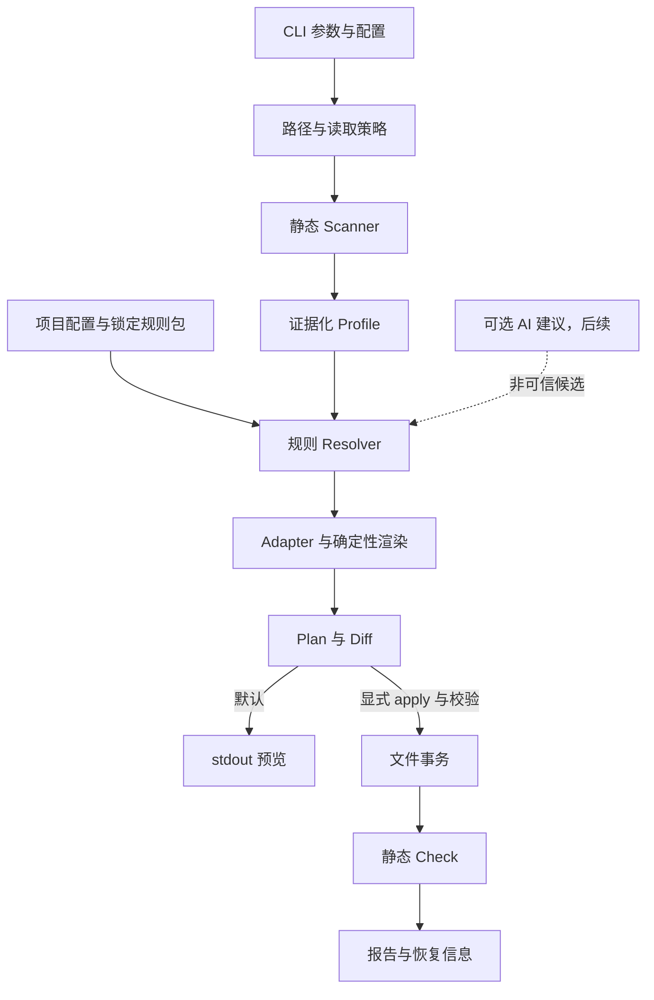

# 技术架构设计

版本：V0.2；状态：设计草案；关联：[PRD](01-PRD.md)、[规则引擎](03-Rule-Engine-Design.md)、[CLI 协议](04-CLI-SDD.md)。所有代码路径为拟议结构。

## 1. 系统边界（D-ARCH）

产品是运行在用户授权目录内的 CLI。扫描器读取工程证据，规则引擎产生确定性候选结果，计划器输出差异，写入器只应用明确授权的文件计划。默认路径不需要网络、模型或 Shell。

产品品牌为 Oh My Blueprint，目标 Go Module 为 `github.com/bingooyong/oh-my-blueprint`，入口为 `cmd/ombp/`，输出二进制 `ombp`。配置使用 `.ombp/`；保留全局命名空间 `~/.ombp/` 与环境变量前缀 `OMBP_`，MVP 不读取或创建全局目录，具体变量未定义前不提供隐藏开关。

CI 调用相同的检查服务，不进入交互，不自动修复。`AGENTS.md` 是输出文件；硬权限、分支保护和发布审批由外部平台执行。

## 2. 模块与依赖

| 拟议路径 | 职责 | 禁止承担的职责 |
| --- | --- | --- |
| `cmd/ombp/` | 参数、退出码、stdout/stderr、依赖组装 | 在命令回调中直接修改规则文件 |
| `internal/scanner/` | 有界遍历、探测器、来源定位和模块证据 | 执行清单脚本、安装依赖、读取凭证 |
| `internal/profile/` | 自动事实、人工值、未知与变化模型 | 按置信度自动确认业务含义 |
| `internal/rules/` | 规则包和 Schema 校验、来源解析 | 网络任意下载或执行规则内代码 |
| `internal/resolver/` | 选择、依赖、作用域、约束和冲突 | 静默压过不可覆盖规则 |
| `internal/renderer/` | 字节稳定的正文、区块和导航 | 渲染期间扫描工程或调用外部服务 |
| `internal/adapters/` | 目标工具能力、路径和加载预算映射 | 修改工具权限配置、假定引用会自动加载 |
| `internal/governance/` | Check、后续 Audit/漂移、结构化 findings | 将静态检查升级成运行验收 |
| `internal/updater/` | 快照、计划、校验、备份、事务和恢复 | 自动接管无归属文件、删除用户文件 |
| `internal/skills/` | Phase 4 的目录、解析、安全审查与安装计划 | 将推荐直接转换为脚本执行 |
| `internal/config/` | 配置、锁与版本迁移 | 从仓库配置放宽外部强制策略 |
| `internal/security/` | 路径边界、敏感文件策略、输入预算 | 以字符串黑名单代替路径安全检查 |
| `internal/report/` | 报告模型、证据级别、脱敏和序列化 | 混入业务推断和文件写入逻辑 |

依赖方向为 CLI → 应用编排 → 领域模块 → 受限 I/O。画像和报告模型不依赖适配器；渲染器接收已解析的规则集。只有 updater 具备产品输出写入能力。首期保留 internal 边界，未有真实外部调用方时不提前抽象公共 `pkg` SDK。

## 3. 数据与生命周期（D-DATA）

| 文件/对象 | 角色 | 写入时机 | 版本管理建议 |
| --- | --- | --- | --- |
| `.ombp/project.yaml` | 人工配置、目标工具、排除项、显式技术栈与规则选择 | 计划应用或人工编辑 | 提交 |
| `.ombp/profile.json` | 扫描事实及证据，不存凭证值或完整源码 | 计划应用；普通 scan 默认 stdout | 提交前审查元数据敏感性 |
| `.ombp/rules/custom/*.md` | 项目自定义规则源 | 人工或明确规则编辑计划 | 提交 |
| `.ombp/rules/overrides/*.yaml` | 可覆盖规则的替代/例外记录 | 经校验的显式计划 | 提交；MVP 不支持 P1 弱化例外 |
| `.ombp/lock.yaml` | 锁定版本、内容摘要、生成归属和基线摘要 | 与输出同一事务最后提交 | 提交 |
| 内置规则包 | 工具发布附带的版本化源 | 发行构建；扫描时只读 | 在产品仓库维护 |
| `.ombp/reports/` | 用户明确要求保存的报告 | `--output` 指定 | 默认不提交，人工审查后选用 |
| `.ombp/state/` | 写锁、恢复日志、受管基线和备份 | apply 时 | 不提交，默认限制访问权限 |
| `AGENTS.md` 等 | 编译产物，保留手工区 | apply 时 | 提交 |

上表是后续工具对目标工程的约定，不在本轮创建这些文件。首次应用应提示目标工程忽略 state/备份；只有计划明确列出时才可修改其 `.gitignore`。

项目规则源由“锁定的内置包 + 显式项目自定义与覆盖记录”组成；输出文件和临时缓存都不能反向变成无来源的规则源。画像与 lock 不记录绝对用户主目录，计划在本机保存目标规范路径以防误用。

画像保留每条事实的 `detected_value`、`evidence`、`confidence`、`status`；配置中的人工值用 `declared_value`、来源与备注表达。二者不一致产生 finding，人工确认不删除原始证据。

## 4. 扫描与命令证据（D-SCAN）

遍历按规范相对路径排序，记录配置决定、忽略原因和覆盖率。默认忽略 `.git`、依赖目录、构建产物、备份及输出状态目录。敏感文件先做路径分类再打开；允许读取清单必须同时通过敏感路径拒绝策略。已识别敏感文件和符号链接不跟随、不读取内容。

对候选清单设置单文件、文件数、遍历深度与总读取量预算。达到预算标记 `incomplete` 并返回扫描失败；排除明确声明的无关目录不视为失败，但报告需包含排除范围。二进制和恶意超大/深层数据不进入解析器。

命令模型至少包含 `argv` 或原始声明、`cwd`、来源文件与键、包管理器证据、所需环境及验证状态。`package.json#scripts.test` 存在只可得到 `declared`；Make 目标文本只可得到 `candidate`，复杂动态定义为 `unknown`。CI 中出现的命令须标记平台条件，不能直接转换成本地必可用命令。

`check` 可以发现脚本键被删除、锁文件变更、来源文件摘要变化；无法通用判断任意 Shell 字符串是否有效，也不能静态验证运行时依赖。命令执行状态固定为 `NOT_RUN`，直到未来独立探测流程产生真实退出结果。

## 5. 写入与恢复（D-WRITE）

计划绑定根目录、工具/Schema/适配器版本、输入文件摘要、当前输出摘要、锁摘要、变更清单和期望新摘要。授权来自 CLI 的显式 apply 或会话给定的具体计划范围；计划 JSON 自称“已批准”不构成权限。产品受管输出与报告限于目标根内；唯一根外输出例外为用户明确指定的预览计划文件，仍执行不覆盖、不跟随链接和敏感路径拒绝检查。

写入前重新验证配置和扫描快照；并发变更、符号链接、路径穿越、所有权无法确认、损坏标记或不支持版本均阻断。写入过程采用目录级互斥、受限权限临时文件、同文件系统单文件原子替换与写前恢复日志。**多个文件的修改并非操作系统级原子事务**；进程崩溃由日志和旧内容备份恢复。

修改前保存允许写入文件的原始内容及摘要。失败时仅在当前摘要仍等于本事务新值时恢复旧值；发现第三方新改动就保留现场并报告人工恢复，不强行覆盖。下次运行先检查未完成事务，check 可读报告，apply 阻断直到恢复完成。详情见规则引擎设计。

## 6. 技术选型与决策记录

以下为文档方案，尚未引入依赖。正式采纳前完成 WP-00 的版本、许可证、安全和维护状态核查。

| 决策 | 状态 | 建议及理由 | 备选与代价 |
| --- | --- | --- | --- |
| ADR-001 | 提议 | Go CLI；单一二进制、标准库扫描和测试，适合本地离线 | Python/Node 生态便利但增加目标环境运行时要求 |
| ADR-002 | 提议 | Cobra 处理子命令；文件配置不先引入全能配置框架 | 标准 flag 依赖少，但多子命令帮助与验证需自行维护 |
| ADR-003 | 提议 | JSON 为交换/报告，YAML 为人工配置和 lock，Markdown 为规则正文 | 全 JSON 简化解析但人工规则可读性较低 |
| ADR-004 | 提议 | 有版本的严格 Schema + 业务校验；YAML 禁任意对象构造，限制别名、重复键和展开量 | Schema 库与自定义校验器需小样本比较后定型 |
| ADR-005 | 提议 | 内置规则 + 锁定自定义源编译为工具原生输出 | 直接复制模板难以追溯、审计和跨工具同步 |
| ADR-006 | 提议 | text/template 确定性渲染，允许函数清单固定 | 可执行插件/任意模板函数会扩大安全面，首期不支持 |
| ADR-007 | 提议 | 先本地包、后 Registry 与可选 AI | 联网中心服务不满足离线与敏感工程需求 |
| ADR-008 | 提议 | GoReleaser 后续用于发布；先平台构建/测试矩阵 | 分发渠道和签名均须另行完成发布验证 |

Go 版本、Cobra/YAML/Schema 依赖库及版本、发行安装命令尚未确定；自有 Module 与二进制命名已按 OMBP 规范统一。本轮不得据此生成依赖清单或执行安装。

## 7. 多工具、Skills 与 AI 扩展（D-EXT）

适配器先声明工具版本窗口、验证日期、支持的输出路径、目录语义、导入、字节预算和不支持功能，再进行编译。加载规则以各工具官方机制为准；产品的规则优先级不能改变 Agent 的系统指令、全局设置或工具权限。

Codex 适配在首期完成；Claude Code 和 Cursor 分别验证导入及作用域，不能把 Markdown 链接当作工具支持的导入。全局规则只作为可显式提供的只读上下文；初始化默认不写 `~/.codex`、`~/.claude` 或用户全局目录。

Skills 元数据须包含不可变来源 revision、摘要、许可证、依赖、兼容工具与安全审查状态。远程包下载属于单独授权的后续功能；只安装到适配器确认支持的项目目录，不执行安装钩子、不隐式配置 MCP。内容扫描只提供风险线索，不能证明第三方 Skill 无恶意指令。

自有规则包使用 `ombp-core`、`ombp-security` 等名称，自有 Skills 使用 `ombp-project-init`、`ombp-code-review` 等名称；第三方包保留来源命名，不冒充 OMBP 官方包。规则 ID 与包名前缀分开管理，稳定的 `security.*` 等 ID 无需机械添加品牌前缀。

可选 AI 在 Phase 5 接收最小化脱敏画像，默认不接收源码。网络服务、数据范围与凭证来源须明确配置；API Key 从授权环境/凭证设施读取，不写 profile、lock 或报告。模型输出进入候选区，带来源和不确定性，再经同一校验和计划流程。模型文本和第三方规则文本均作为数据处理，不能下发工具执行权限。

## 8. 可观察性与演进

报告记录阶段、工具版本、输入指纹、覆盖率、findings、命令执行状态和输出差异。默认只在 stdout 输出必要信息，诊断信息在 stderr；无遥测、无自动上传。

Schema 主版本不兼容时拒绝写入，迁移需要独立预览与备份。规则包和适配器升级必须重新生成计划，不能在 check 时顺带更新。CI 集成只调用固定版本命令，分支保护是否启用须由平台实证确认。
