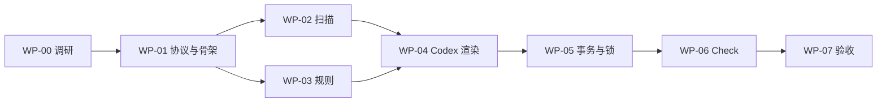

# 实施规划

版本：V0.2；状态：2026-11-20 建立设计，2026-11-21 已按用户明确授权进入 Trellis 实施。当前代码、阶段缺口与实际证据记录在任务 DAG 和各任务产物，尚未整体验收。

全部工作包使用 Oh My Blueprint / `ombp` 命名基线，目标 Go Module、`.ombp/` 配置、`ombp-` 自有包名及 `agents` 用户命令统一遵循[命名规范](08-Naming.md)。Trellis 主任务及 15 个子任务已建立，执行顺序与状态见 implementation/task-dag.json；本表保持范围与依赖规划。

## 1. 阶段与门禁

| 阶段 | 目标与交付 | 进入/退出门禁 |
| --- | --- | --- |
| Phase 0 | 产品/Schema/协议评审，官方机制调查，依赖选型与规则基线 | 关键歧义关闭，版本/许可可追溯，MVP 用例冻结；本次文档只是其输入 |
| Phase 1 | CLI MVP：scan/profile/init/diff/check、Codex、文件保护、基础 lock、自定义规则 | AC-01～10 对应范围有真实测试；文件保护与恢复安全项全部通过 |
| Phase 2 | update/audit、规则版本升级、漂移/重复/过期检测和恢复工具 | 旧基线迁移、人工区保护、三方差异、坏锁与中断路径验证 |
| Phase 3 | Claude Code、Cursor 和规则同步；Gemini 按能力验证扩展 | 每个适配器有官方依据、原生加载实验和不支持能力报告 |
| Phase 4 | Skills Registry、推荐、来源审查、项目内安装/更新/卸载 | 不执行第三方钩子；依赖/路径/来源/版本与内容审查可追溯 |
| Phase 5 | 可选 AI 解释、推荐、语义审计和变更建议 | 默认关闭、明确数据范围、脱敏与不可自动应用验证 |
| Phase 6 | 企业规则包、私有 Registry、例外签发、CI 集成和健康报告 | 阻断行为、权限边界、规则发布与跨项目升级有实证 |

简单的 `check --ci` JSON/退出码从 MVP 起支持；Phase 6 才扩展企业策略与平台治理。基础 lock、结构化冲突和受管哈希同样属于 MVP，不能等 Phase 2 才补安全底座。

## 2. MVP 工作包

以下责任为角色建议，尚未指派人员。不得将工作包表中的目标目录当作已实现代码。

| 编号 | 工作内容与产物 | 依赖 | 建议责任 | 退出证据 |
| --- | --- | --- | --- | --- |
| WP-00 | 官方加载/Skills 路径核实，Go/Cobra/YAML/Schema 版本许可评估，明确原生平台窗口；核实 OMBP 分发命名空间与目标 Module | 无 | 架构/依赖研究 | 资料账本、版本决策、命名核查、剩余风险 |
| WP-01 | CLI 工程骨架、报告模型、错误码、配置与 Schema、内置资源打包 | WP-00 | CLI 开发 | 参数/版本/非法输入测试、离线构建 |
| WP-02 | 路径与敏感文件策略、有界遍历、Go/Python/TS/React 探测器、画像 | WP-01 | Scanner 开发 | AC-01、敏感读取/遍历夹具、实测资源预算 |
| WP-03 | 十五领域基线正文、规则元数据、依赖/冲突/作用域解析与 canonical manifest | WP-01 | 规则开发/维护者 | AC-07、同版本异内容、依赖环、未知条件测试 |
| WP-04 | Codex 能力描述、text/template、根/目录规则、指令预算、Golden | WP-02/03 | Adapter 开发 | AC-02、跨目录加载与大小预算证据 |
| WP-05 | 所有权、计划绑定、Diff、互斥、备份/journal、apply、基础 lock 与恢复路径 | WP-04 | 文件事务开发 | AC-03/04/05/08、各替换点故障注入 |
| WP-06 | 静态 check、命令来源和路径检查、findings、CI JSON/退出码 | WP-05 | 治理开发 | AC-06、错误码矩阵、无写入断言 |
| WP-07 | CLI E2E、平台矩阵、用户指南、需求追溯和版本验收 | WP-06 | 测试/交付 | AC-09/10、实际报告、未运行项与风险 |

WP-02/03 在项目画像与规则领域的数据接口冻结后可并行，不依赖 Phase 5 的 AI 接口；测试用例随工作包编写，WP-07 汇总验收，不把测试全部推迟到末尾。未完成文件保护和恢复验证不得向真实项目推广。

## 3. 后续工作包

| 编号 | 内容 | 前置 |
| --- | --- | --- |
| WP-08 | 漂移指纹、规则版本升级、audit/update、恢复与接管专用协议 | Phase 1 验收 |
| WP-09 | Claude/Cursor 适配、能力测试、跨工具输出一致性 | WP-08、官方机制复核 |
| WP-10 | Skills 本地目录与元数据、安全审查、依赖/来源锁定和项目内安装 | Phase 1；安装路径依赖 WP-09 相应适配能力 |
| WP-11 | 外部 Registry、下载缓存、来源认证与撤销策略 | WP-10、本地离线流程稳定 |
| WP-12 | 显式 AI 接口、最小脱敏输入、语义建议与解释证据 | WP-08、数据出域方案 |
| WP-13 | 企业包、P1 有效期例外、私有 Registry、签发和升级治理 | WP-11、组织授权机制 |
| WP-14 | 平台 CI 示例、分支保护核查、批量健康报告和可重复分发 | 各被集成能力已经验收 |

不先给无法支撑的固定工期。Phase 0 完成样本、依赖与平台风险评估后，再给人力/工期估算和发布目标。未交付功能在 CLI help 中不得伪装为成功空实现。

## 4. 决策与风险清单

| 编号 | 风险或待决策 | 处理动作与责任阶段 |
| --- | --- | --- |
| R-01 | 用户期望“任何工程”，首期探测覆盖有限 | 用支持矩阵与 unknown 输出限制承诺；Phase 0 固定样本 |
| R-02 | 自然语言冲突无法完备检测 | 结构化约束先行，语义疑点人工审查；不宣传全自动合规 |
| R-03 | Agent 加载机制与 Skills 路径变化 | 适配器版本窗口、资料日期、原生实验；WP-00/09 |
| R-04 | 手写规则与多工具派生产物冲突 | 不自动接管，单独迁移；保留归属和差异；WP-05/08 |
| R-05 | 多文件写入崩溃、平台重命名差异和 TOCTOU | journal、摘要前置检查、故障注入、原生平台测试；WP-05/07 |
| R-06 | 第三方规则/Skill 提示注入与供应链风险 | 默认离线、锁 revision/摘要、审查来源和内容、不执行钩子；WP-10/11 |
| R-07 | AI/报告泄漏内部项目数据 | 默认无模型、最小化元数据、报告脱敏和出域授权；WP-12 |
| R-08 | 长 AGENTS.md 超出工具读取预算 | 按路径校验累计加载大小，必要时精简并人工确认；WP-04 |
| R-09 | 统一模型与工具原生语义不等价 | 适配器缺口显式报告，不能静默丢弃规则；WP-09 |
| R-10 | 硬门禁尚未配置却宣称已保护主分支 | 平台检查与产品检查分开验收；WP-14 |
| R-11 | `oh-my-blueprint` / `ombp` 的分发或品牌空间冲突 | GitHub、包、命令、域名与商标分别核实；未核实不宣称可注册或唯一；WP-00 |

## 5. 发布与规则维护

后续发布分别记录 CLI、Schema、规则包、适配器和 Skills 版本，不以工具版本替代所有内容版本。发行物需可追溯到提交、平台构建和测试；签名、Homebrew、Go install 等渠道在实际配置并验证前只列候选。

`ombp evolve` 保留为后续演进建议入口，在漂移与版本更新能力稳定后再单独设计和验收，不扩展 MVP 为自动规则修改工具。

每次变更先对照需求编号，更新相关设计和测试映射。长期约束经评审进入规则源；一次性任务结果进入报告。规则包升级先产生跨项目影响清单和差异，不批量覆盖。文档修订不自动表示产品阶段验收通过。
